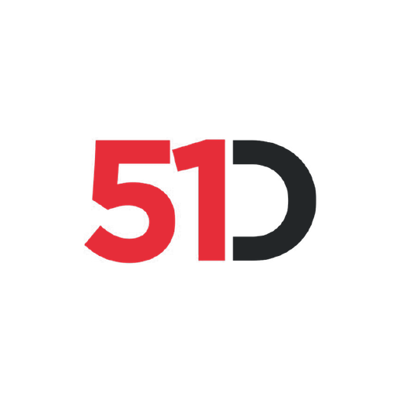

# 51Degrees Device Detection and IP Intelligence data files



**The free data files and test evidence for the 51Degrees SDKs**

The examples and tests in the 51Degrees SDKs use these files for
[Device Detection](https://51degrees.com/device-detection?utm_source=github&utm_medium=readme&utm_campaign=data&utm_content=readme&utm_term=introduction)
and [IP Intelligence](https://51degrees.com/ip-intelligence?utm_source=github&utm_medium=readme&utm_campaign=data&utm_content=readme&utm_term=introduction).
As a submodule named `data`, the two folders are `data/device-detection` and
`data/ip-intelligence`.

## Get the data files

The data files are not stored in this repository. Each one is listed as a
`.link` file in the folder where the examples and tests look for it, and
the link file holds the address the data file is downloaded from. No
License Key is needed. These scripts download every linked file into
place.

```pwsh
./get-data-files.ps1
```

```sh
./get-data-files.sh
```

To download only some files, name them or their folders, for example
`./get-data-files.sh 51Degrees-LiteV4.1.hash` or
`./get-data-files.ps1 ip-intelligence`. A file that is already there is
kept. Add `-Update` (PowerShell) or `-u` (shell) to replace the files that
have a newer version, or `-Force` or `-f` to download them all again. The
shell script needs `curl` and `gzip`.

To get the files straight after cloning, run the script in the same
command.

```sh
git clone https://github.com/51Degrees/data.git && data/get-data-files.sh
```

Where this repository is a submodule called `data`, the same works once
the submodule is checked out.

```sh
git submodule update --init data && data/get-data-files.sh
```

The Distributor allows each file to be downloaded a limited number of
times an hour from one address, and a script that reaches the limit says
when to try again. The scripts send a `source` value with each download
from the Distributor, so that 51Degrees can count which files are used.
It is `ci-<repository>` in GitHub Actions and `data` elsewhere, unless
`-Source` or `-s` gives another.

## What is here

### device-detection

| File | What it is |
| --- | --- |
| `51Degrees-LiteV4.1.hash` | The Lite on-premise Device Detection data file. Downloaded by the scripts. |
| `20000 User Agents.csv` | 20,000 of the most commonly seen User-Agents, one per line. Downloaded by the scripts. |
| `20000 Evidence Records.yml` | 20,000 of the most commonly seen sets of HTTP headers, including [User-Agent Client Hints](https://learnclienthints.com/), one YAML record per set. Downloaded by the scripts. |
| `metrics/` | Charts of the data's coverage of browsers, hardware, operating systems and crawlers. |

The Lite file gives IsMobile, ScreenPixelsHeight, ScreenPixelsWidth,
PlatformName, PlatformVersion, PlatformVendor, BrowserName, BrowserVersion,
BrowserVendor, SetHeaderBrowserAccept-CH, SetHeaderHardwareAccept-CH,
SetHeaderPlatformAccept-CH, JavascriptGetHighEntropyValues and
JavascriptHardwareProfile. It is built from a subset of all devices and
is updated less often than the paid data files.

### ip-intelligence

| File | What it is |
| --- | --- |
| `51Degrees-LiteV41.ipi` | The Lite on-premise IP Intelligence data file, giving RegisteredCountry, RegisteredName and RegisteredOwner. Downloaded by the scripts. |
| `51Degrees-IPIV4AsnIpiV41.ipi` | The Asn data file, giving Asn and AsnName. Downloaded by the scripts. |
| `evidence.csv`, `evidence.yml` | 20,000 random IPv4 and IPv6 addresses for the examples and tests. |
| `evidence-gen.ps1` | Makes a new set of random addresses, for example `./evidence-gen.ps1 -v4 10000 -v6 10000 "evidence.yml"`. |
| `CountryCodes.json`, `Translations/` | Country names in English and 16 other languages, used by the translation engine and its examples. |

## More properties

The Lite files carry a small set of properties. The
[cloud service](https://51degrees.com/developers?utm_source=github&utm_medium=readme&utm_campaign=data&utm_content=readme&utm_term=more-properties)
and the paid data files carry hundreds more, from hardware model and price
band to location, connection type and Human Confidence. See
[pricing](https://51degrees.com/pricing?utm_source=github&utm_medium=readme&utm_campaign=data&utm_content=readme&utm_term=more-properties)
for the options.

## Find out more

- [Device Detection](https://51degrees.com/device-detection?utm_source=github&utm_medium=readme&utm_campaign=data&utm_content=readme&utm_term=find-out-more)
- [IP Intelligence](https://51degrees.com/ip-intelligence?utm_source=github&utm_medium=readme&utm_campaign=data&utm_content=readme&utm_term=find-out-more)
- [Documentation](https://51degrees.com/documentation/index.html?utm_source=github&utm_medium=readme&utm_campaign=data&utm_content=readme&utm_term=find-out-more)
- The SDKs that use these files, for
  [C and C++](https://github.com/51Degrees/51degrees-cxx),
  [.NET](https://github.com/51Degrees/51degrees-dotnet),
  [Go](https://github.com/51Degrees/51degrees-go),
  [Java](https://github.com/51Degrees/51degrees-java),
  [Nginx](https://github.com/51Degrees/51degrees-nginx),
  [Node.js](https://github.com/51Degrees/51degrees-node),
  [PHP](https://github.com/51Degrees/51degrees-php),
  [Python](https://github.com/51Degrees/51degrees-python),
  [Rust](https://github.com/51Degrees/51degrees-rust) and
  [Varnish](https://github.com/51Degrees/51degrees-varnish)
